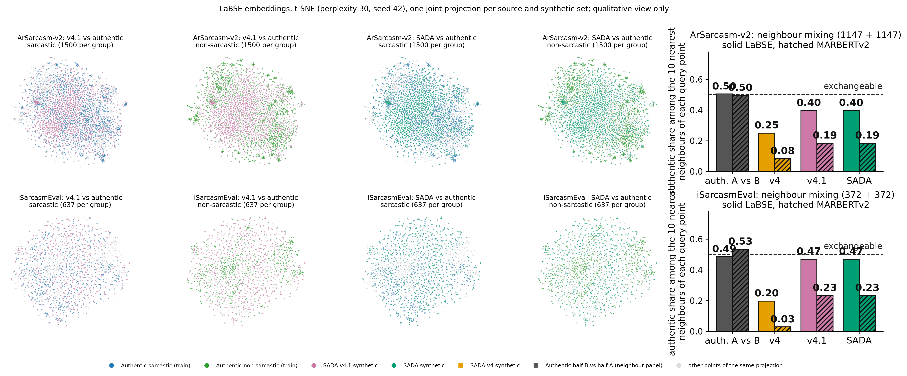
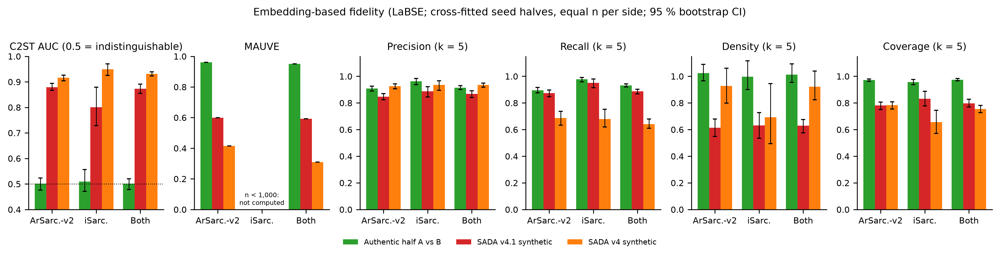
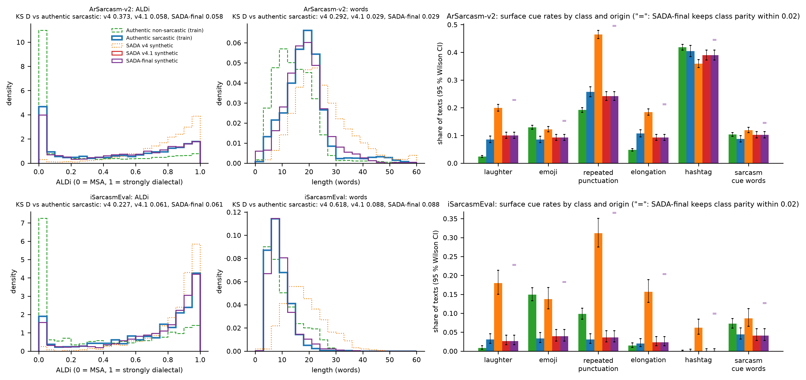
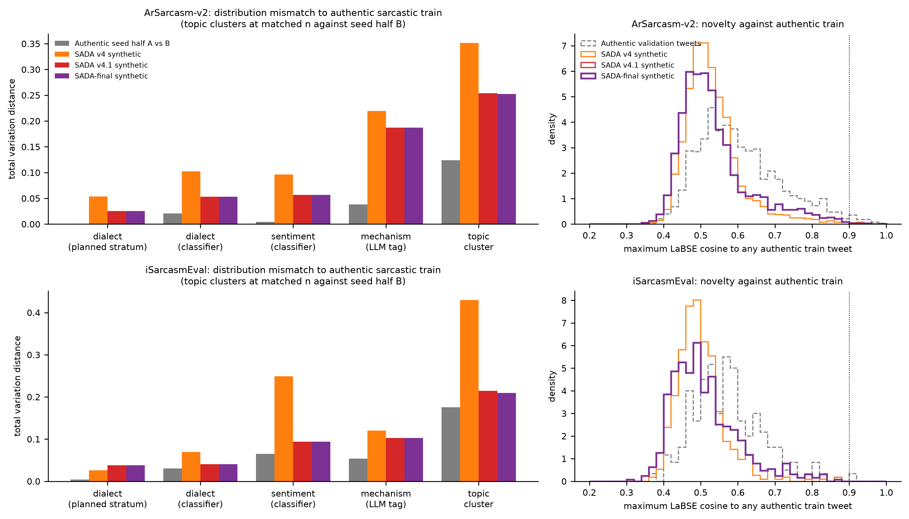
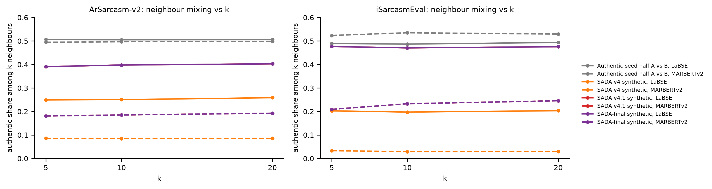

# SADA

Training-only synthetic sarcastic Arabic tweets used in the FDL-ASD paper.

**SADA** = Stratified, Anchored, Diverse Augmentation. This release is the paper cut of **4,229** synthetic sarcastic tweets derived from authentic **training** seeds only. Validation and test stay authentic.

Frozen 2026-11-08 from the refinement set `D1.5-w0.3` (see `data/manifest.json`). Internal build label was sometimes written “SADA-final-C”; the public name is **SADA**.

---

## Quick layout

| Path | What it is |
|---|---|
| `data/sada.csv` | **4,229** synthetic sarcastic rows (release columns) |
| `data/sada_train_tagged.csv` | Same rows with `[SYN]` + source tags for curriculum training |
| `data/sada_teacher_pens.csv` | Soft teacher targets from verifier ensemble |
| `splits/train.csv` | Paper training mix: 18,548 authentic + 4,229 SADA (**22,777**) |
| `splits/validation.csv`, `splits/test.csv` | Authentic only (**2,318** each) |
| `docs/figures/` | t-SNE / neighbour-mixing and validation plots |

---

## Data distribution (paper splits)

Numbers below match the FDL-ASD data-distribution table and the CSVs in this package.

### Authentic split (80 / 10 / 10, stratified by source × label)

Percentages in parentheses are the **sarcastic share** within that cell.

| Source | Train | Validation | Test | SADA (train only) |
|---|---:|---:|---:|---:|
| ArSarcasm-v2 | 11,144 (20.6%) | 1,392 (20.5%) | 1,392 (20.5%) | +3,443 |
| iSarcasmEval (Arabic) | 2,388 (31.3%) | 300 (31.3%) | 300 (31.3%) | +786 |
| Arabic news headlines | 5,016 (50.2%) | 626 (50.2%) | 626 (50.2%) | — |
| **All authentic** | **18,548 (30.0%)** | **2,318 (29.9%)** | **2,318 (29.9%)** | — |
| **+ SADA** | **22,777 (43.0%)** | 2,318 | 2,318 | **4,229** |

### Class balance (from `splits/`)

| Split | Non-sarcastic | Sarcastic | Total | Notes |
|---|---:|---:|---:|---|
| Authentic train | 12,989 | 5,559 | 18,548 | Real posts only |
| SADA train add-on | 0 | 4,229 | 4,229 | All synthetic rows are sarcastic |
| Train (auth + SADA) | 12,989 | 9,788 | 22,777 | ~43% sarcastic |
| Validation | 1,624 | 694 | 2,318 | Authentic only |
| Test | 1,624 | 694 | 2,318 | Authentic only |

### Authentic train by source × label

| Source | Non-sarcastic | Sarcastic | Total |
|---|---:|---:|---:|
| ArSarcasm-v2 | 8,848 | 2,296 | 11,144 |
| iSarcasmEval | 1,641 | 747 | 2,388 |
| Arabic headlines | 2,500 | 2,516 | 5,016 |

### SADA by source

| | ArSarcasm-v2 | iSarcasmEval | Total |
|---|---:|---:|---:|
| SADA | 3,443 | 786 | **4,229** |

ArSarcasm-v2 rows use a dialect-matched 1.5× dose of the authentic sarcastic train count (2,296). iSarcasmEval contributes all verifier-accepted rows.

### SADA by source × dialect region

| Source | Dialect region | Count | Share |
|---|---|---:|---:|
| ArSarcasm-v2 | MSA | 1,777 | 51.6% |
| ArSarcasm-v2 | Maghreb + Nile Basin | 1,263 | 36.7% |
| ArSarcasm-v2 | Gulf | 228 | 6.6% |
| ArSarcasm-v2 | Levant | 175 | 5.1% |
| iSarcasmEval | Nile Basin | 583 | 74.2% |
| iSarcasmEval | Maghreb | 120 | 15.3% |
| iSarcasmEval | Levant | 40 | 5.1% |
| iSarcasmEval | MSA | 38 | 4.8% |
| iSarcasmEval | Gulf | 5 | 0.6% |

### Generator mix (SADA)

| Generator | Rows |
|---|---:|
| ALLaM-7B SADA v4.1 regeneration | 2,164 |
| ALLaM-7B SADA v4 | 1,298 |
| ALLaM-7B SADA v4.1-more Phase-2 regeneration | 767 |

### Verifier pools (label confidence)

| Pool | Rows | Meaning |
|---|---:|---|
| Strict (ArSarcasm-v2, p_ens ≥ 0.7079) | 2,492 | High-confidence sarcastic |
| Standard (remaining ArSarcasm-v2 + all iSarcasmEval) | 1,737 | p_ens ≥ 0.5 |

---

## Embedding check (same figure as the paper)

LaBSE t-SNE of ArSarcasm-v2 and iSarcasmEval authentic training tweets against the intermediate selected SADA pool (7,390), with neighbour-mixing bars for LaBSE and MARBERTv2 near the exchangeable level 0.5. This is the paper figure — not a plot of the final 4,229 cut alone, and not scored on the authentic test set.

*(File: `docs/figures/sada_tsne_mix.png` — same asset as `fl-asd-paper/figures/sada_tsne_mix.png` / `fig1_tsne_grid.png`.)*

---

## Validation snapshots

Short human captions for a few useful checks from the data-validation suite. These accompany the paper’s funnel / intrinsic numbers (C2ST ≈ 0.869, MAUVE ≈ 0.719, distinct-1 ≈ 0.380 on the 4,229 cut).

### Fidelity bars

Classifier two-sample and related fidelity scores: how easy it is to tell synthetic tweets from authentic sarcastic training tweets (lower / closer to the authentic half-split reference is better).

### Linguistic match

Dialectness (ALDi), length, and surface-cue rates (laughter, elongation, emoji, …) for synthetic vs authentic sarcastic training text.

### Coverage and novelty

How much of the authentic sarcastic neighbourhood the synthetic set covers, and how novel the wording stays relative to held-out authentic text.

### Neighbour mixing by k

Share of authentic neighbours among the k nearest neighbours in embedding space (LaBSE / MARBERTv2). Values near 0.5 look exchangeable with authentic sarcastic text.

---

## How to use it

1. Keep **validation** and **test** authentic (`splits/validation.csv`, `splits/test.csv`).
2. For the paper recipe, train on `splits/train.csv` (already auth + SADA), or start from authentic train and append `data/sada.csv`.
3. Prefer soft labels + down-weighted synthetic loss (paper: λ_syn = 0.3) and an authentic-first curriculum with the tagged file.
4. Do **not** use SADA rows as evaluation data.

Checksums: `data/CHECKSUMS.sha256`. Provenance detail: `data/manifest.json`.

In the FDL-ASD code repo the same files live at `data/sada/sada.csv` (and companions).

---

## What this is not

- Not a redistributed copy of the public ArSarcasm-v2 / iSarcasmEval / headline corpora (those stay in the authentic split files you already hold).
- Not human re-annotated synthetic labels — verifiers confirm sarcasm probability; that remains a limitation.
- Not the larger intermediate pool (7,390) or the older SADA-ArSarc release under `release/SADA-ArSarc` (historical / ablation sets).
